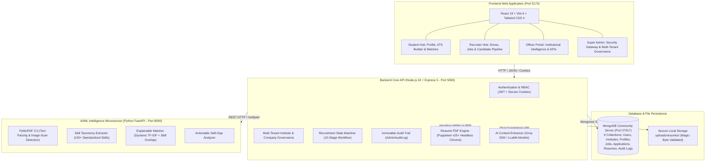

# AI-Powered Campus Placement Intelligence System

A production-ready, full-stack recruitment and placement governance platform combining an editorial user experience with authentic, deterministic AI/ML intelligence. Designed for institutional scale, the system serves four primary stakeholder roles: **Students**, **Recruiters**, **Placement Officers**, and **Platform Administrators**.

---

## 1. System Architecture



---

## 2. Technology Stack & Key Specifications

| Layer | Technologies & Libraries | Key Responsibilities |
| :--- | :--- | :--- |
| **Frontend** | React 19, Vite 6, Tailwind CSS 4, React Router 7, Recharts, Lucide React | Modern editorial UI ("Paper & Ink" theme), responsive dashboards, real-time resume editor, interactive data visualization |
| **Backend** | Node.js 24+, Express 5, Mongoose 9, Puppeteer v25+, Groq SDK, Multer, Helmet, Bcryptjs, JWT | High-security REST APIs, multi-tenant RBAC, binary magic-byte inspection, ATS PDF generation, AI text rewriting |
| **AI/ML Microservice** | Python 3.10–3.14+, FastAPI, Uvicorn, PyMuPDF 2.0 (`pymupdf`), Scikit-learn 1.9+, Pydantic | PDF text extraction, scanned document detection, boundary-aware skill taxonomy parsing, deterministic job match scoring |
| **Database** | MongoDB Community Server (Windows Service / `127.0.0.1:27017`) | Multi-tenant relational-like schema, compound unique indexes, aggregation pipelines, audit logs |

---

## 3. Core Functional Modules

### 🏛️ Module 1: Multi-Tenancy & Institutional Governance
* **Multi-Institute Support:** Multi-tenant architecture through the `Institute` model, allowing universities, colleges, and autonomous institutes to operate independently.
* **Affiliated Placement Drives:** Placement Officers are tethered to their accredited institution, managing student directories, company authorizations, and on-campus recruitment drives.
* **Company Verification & Cross-Campus Authorization:** Companies must be verified by Platform Super Admins before participating in institutional drives.

### 🔐 Module 2: Authentication & Role-Based Access Control (RBAC)
* **Four Canonical Roles:** `SUPER_ADMIN`, `PLACEMENT_OFFICER`, `RECRUITER`, and `STUDENT`.
* **Super Admin Security Gateway:** Dedicated high-security gateway (`/super-admin/login`) with rate-limiting, security passkeys, and multi-factor session validation.
* **Security Hardening:** Password hashing using `bcryptjs` (10 rounds), signed JWTs in `httpOnly`, `SameSite: strict` cookies, Helmet HTTP headers, and CORS whitelist protection.
* **Audit Trail:** Append-only administrative activity logging via `AdminAuditLog`.

### 📄 Module 3: AI Resume Parser & Magic-Byte File Validation
* **Binary Magic-Byte Inspection:** Verifies `%PDF-` file signatures directly on raw binary uploads to block disguised executables or malformed documents.
* **Text & Scanned Document Parsing:** PyMuPDF extracts text streams across multi-page resumes and automatically detects scanned/image-only PDFs lacking selectable text, alerting users when OCR is required.
* **150+ Skill Taxonomy:** Regex-based, boundary-aware extraction matching technical skills across Languages, Web Frameworks, Cloud, DevOps, AI/ML, and Databases.
* **Interactive Skill Verification:** Students can review, accept, reject, or manually add extracted technical competencies before syncing to their placement profile.

### 📝 Module 4: ATS Resume Builder & AI Content Enhancer
* **5 Modern ATS Templates:**
  1. *Modern Minimalist:* Clean single-column layout with About Me and prioritized projects.
  2. *Technical Developer:* Technology-forward design highlighting stack, GitHub/portfolio links, and systems engineering.
  3. *Fresher Graduate:* Early-career layout focused on education, academic coursework, and certifications.
  4. *Modern ATS Professional:* Crisp, recruiter-friendly enterprise design with balanced metrics.
  5. *Corporate Experienced:* Deep chronological timeline with quantifiable business achievements.
* **Side-by-Side Live Preview:** Real-time resume preview synchronized with the student's verified profile data.
* **AI-Powered "Improve with AI":** Powered by Groq LLaMA models (`llama-3.1-8b-instant`) to rewrite summaries and project descriptions into action-oriented, metrics-driven bullet points.
* **Chromium PDF Compilation:** High-resolution server-side PDF generation using headless Puppeteer v25+ with direct binary MongoDB storage.
* **Direct Resume Replacement:** Replace active student application resumes with the newly generated ATS PDF in one click.

### 🎯 Module 5: Explainable AI Recommendation & Skill-Gap Analysis
* **Dynamic Weight Renormalization Formula:**
  $$\text{Match Score} = w_{\text{req}} \times \text{Required Skills Overlap} + w_{\text{pref}} \times \text{Preferred Skills Overlap} + w_{\text{tfidf}} \times \text{TF-IDF Cosine Similarity}$$
  *Baseline Weights:* $w_{\text{req}} = 0.70$, $w_{\text{pref}} = 0.15$, $w_{\text{tfidf}} = 0.15$.  
  If a job does not define preferred skills or text corpus, the active weights dynamically renormalize to sum to $1.0$ without falsely granting $100\%$ score.
* **Independent Hard Eligibility Gates:**
  - Minimum CGPA verification.
  - Maximum permitted active and historic backlogs.
  - Target graduation batch year validation.
  - Department synonym matching (`departmentMatch.js`), normalizing variants such as "CSE" and "Computer Science and Engineering".
* **Actionable Skill-Gap Diagnostics:** Missing skills are flagged into **High Priority** (missing required skills) and **Medium Priority** (missing preferred skills), complete with suggested learning roadmaps.

### 🔄 Module 6: Recruitment Pipeline & Application State Machine
* **10-Stage Recruitment Lifecycle:**  
  `Applied` $\rightarrow$ `Shortlisted` $\rightarrow$ `Under Review` $\rightarrow$ `Assessment` $\rightarrow$ `Interview` $\rightarrow$ `Selected` / `Rejected` / `Withdrawn` / `Offer Declined` / `Offer Revoked`.
* **Duplicate Prevention:** Compound database index `{ student: 1, job: 1 }` prevents duplicate submissions.
* **Immutable Status History:** Every stage transition logs the authorized user, timestamp, decision rationale, and recruiter feedback notes.
* **Automatic Status Synchronization:** Selecting a candidate updates their profile placement status to `placed` across the platform.

### 📊 Module 7: Placement Analytics & Institutional Intelligence
* **MongoDB Aggregation Pipelines:** Real-time data processing across student populations, recruitment drives, and applications:
  - Real-time conversion percentages and placement velocity.
  - Department-wise placement performance with average CGPA correlation.
  - Recruitment funnel stage distribution visualized with interactive Recharts charts.
  - Skill supply-versus-demand matrix highlighting campus talent deficits.
  - One-click CSV student directory export for placement audits.

---

## 4. Database Schema Overview

```
campus_placement/
├── institutes          # Multi-tenant colleges, universities & domains
├── users               # Authenticated identities across all 4 roles
├── studentprofiles     # Academic details, CGPA, backlogs, skills & projects
├── resumeanalyses      # PyMuPDF parsed metadata, extracted skills & confidence scores
├── generatedresumes    # Built ATS resumes, template metadata & binary PDFs
├── companies           # Registered employers, verification flags & authorized institutes
├── jobs                # Job drives, eligibility criteria, required/preferred skills
├── applications        # Student job submissions, status history & recruiter audit trail
└── adminauditlogs      # Append-only security and administration event log
```

---

## 5. System Logins & Portals Directory

The platform enforces strict role isolation across four dedicated login gateways to prevent privilege escalation and role-confusion attacks. Each portal is tailored with role-specific views and controls:

### Portal Overview & Access Matrix

| Portal | Canonical Role | Frontend Web Route | Primary Backend API | Access / Creation Policy | Post-Login Destination |
| :--- | :--- | :--- | :--- | :--- | :--- |
| **Student Portal** | `STUDENT` | [`/student/login`](http://localhost:5173/student/login)<br>*(alias `/login`)* | `POST /api/auth/login`<br>`{ expectedRole: "STUDENT" }` | **Self-Registration:** Students register at [`/student/register`](http://localhost:5173/student/register) by selecting their accredited Institute. | `/student/dashboard` |
| **Recruiter Portal** | `RECRUITER` | [`/recruiter/login`](http://localhost:5173/recruiter/login) | `POST /api/auth/login`<br>`{ expectedRole: "RECRUITER" }` | **Controlled Provisioning:** Public self-registration is disabled. Recruiters are provisioned by verified companies, Placement Officers, or Super Admin. | `/recruiter/dashboard` |
| **Placement Officer Portal** | `PLACEMENT_OFFICER` | [`/officer/login`](http://localhost:5173/officer/login)<br>*(alias `/placement-officer/login`)* | `POST /api/auth/login`<br>`{ expectedRole: "PLACEMENT_OFFICER" }` | **Institutional Appointment:** Provisioned per institute by Super Admin via Admin Dashboard or CLI script `npm run create-officer`. | `/officer/dashboard` |
| **Super Admin Security Gateway** | `SUPER_ADMIN` | [`/super-admin/login`](http://localhost:5173/super-admin/login)<br>*(alias `/admin/security-gateway`)* | `POST /api/auth/super-admin/login`<br>*(alias `/api/auth/admin/secure-gateway-login`)* | **High-Security Bootstrap:** Bootstrapped once via CLI `node backend/scripts/bootstrapAdmin.js` or `npm run create-admin`. Protected by rate limiting and lockout. | `/admin/dashboard` |

---

### Configured Accounts & Test Credentials

The local database and CLI provisioning utilities support the following accounts for immediate testing across all four roles:

| Role | Name | Email | Default / Seed Password | Description & Key Responsibilities |
| :--- | :--- | :--- | :--- | :--- |
| **Super Admin** | Lokesh | `supercampus@gmail.com` | *(Account configured in DB)* | Global system governance, institute & company verification, role elevation, security audit logs |
| **Super Admin (CLI Default)** | Super Administrator | `admin@campus.edu` | `AdminPassword@123` | Default credential provisioned when running `npm --prefix backend run create-admin` |
| **Placement Officer** | Kiran | `kiran@ratnamsolutions.com` | *(Account configured in DB)* | Institutional placement director: drives, student directory, academic updates, analytics |
| **Placement Officer (CLI Default)** | Placement Officer | `officer@campus.edu` | `OfficerPassword@123` | Default credential provisioned when running `npm --prefix backend run create-officer` |
| **Recruiter** | Vishnu | `vishnu@ratnamsolutions.com` | *(Account configured in DB)* | Verified employer recruiter: posting job drives, reviewing applicants, stage progression |
| **Student** | Praveen | `praveen@ratnamsolutions.com` | *(Account configured in DB)* | Student applicant: ATS resume builder, AI job recommendations, one-click job applications |
| **Student** | Prasanth | `prasanth@ratnamsolutions.com` | *(Account configured in DB)* | Student applicant: technical portfolio, profile skills management, application tracking |

> [!NOTE]
> - **Role Enforcement:** Submitting credentials to the wrong portal (e.g. attempting to log into the Officer portal with a Student account) is automatically rejected by the server even if the password is correct.
> - **Mandatory Password Update:** Accounts flagged with `mustChangePassword: true` are immediately redirected to `/change-password` upon login before gaining access to dashboards.
> - **Brute-Force Protection:** The Super Admin Security Gateway triggers progressive countdown lockouts after repeated failed attempts.

---

## 6. Local Setup & Execution Guide

### Prerequisites
* **Windows 10/11** with PowerShell.
* **Node.js:** v20.x or v24.x LTS (`node -v`).
* **Python:** v3.10 – v3.14 (`py --version`).
* **MongoDB Community Server:** Local Windows service running on `127.0.0.1:27017`.

---

### Option A: One-Click Startup (Recommended)

Double-click `start-services.bat` or run in PowerShell:
```powershell
.\start-services.ps1
```
This automatically boots all three microservices in separate dedicated terminal windows:
* **Frontend Web Application:** [http://localhost:5173](http://localhost:5173)
* **Backend REST API:** [http://localhost:5000](http://localhost:5000)
* **AI/ML Microservice Docs:** [http://127.0.0.1:8000/docs](http://127.0.0.1:8000/docs)

---

### Option B: Manual Service Startup

#### 1. Setup & Launch AI/ML Microservice
```powershell
cd ml-service
py -m pip install -r requirements.txt
py -m uvicorn main:app --host 127.0.0.1 --port 8000 --reload
```
*Health check:* `http://127.0.0.1:8000/health`  
*Swagger Documentation:* `http://127.0.0.1:8000/docs`

#### 2. Setup & Launch Node.js Express Backend
```powershell
cd backend
npm install
npm run install:chrome    # Installs Chromium browser for Puppeteer PDF generator
npm run dev
```
*Health check:* `http://localhost:5000/api/health`

#### 3. Setup & Launch React Vite Frontend
```powershell
cd frontend
npm install
npm run dev
```
*Application URL:* `http://localhost:5173`

---

## 7. Environment Configuration

### Backend (`backend/.env`)
Create a `.env` file inside the `backend/` directory:
```env
PORT=5000
NODE_ENV=development
MONGODB_URI=mongodb://127.0.0.1:27017/campus_placement
JWT_SECRET=super_secret_jwt_passphrase_for_local_development_2026
JWT_EXPIRE=30d
JWT_COOKIE_EXPIRE=30
CLIENT_URL=http://localhost:5173
ML_SERVICE_URL=http://127.0.0.1:8000

# Optional: GroqCloud API for "Improve with AI" (LLaMA-3.1)
GROQ_API_KEY=your_groq_api_key_here
GROQ_MODEL=llama-3.1-8b-instant
```

---

## 8. Administrative CLI Utilities

The system includes dedicated command-line utilities for administration and seeding:

```powershell
# Create or reset the Platform Super Admin account
npm --prefix backend run create-admin

# Interactive secure Super Admin bootstrap (Phase 4 standard)
node backend/scripts/bootstrapAdmin.js

# Create or reset a Placement Officer account
npm --prefix backend run create-officer

# Execute Phase 2 role standardization & schema migrations
npm --prefix backend run migrate:phase2:execute

# Reset database collections (development environment only)
node backend/scripts/resetDatabase.js
```

---

## 9. REST API Reference

| Endpoint Group | Prefix | Key Endpoints | Access Control |
| :--- | :--- | :--- | :--- |
| **Authentication** | `/api/auth` | `/login`, `/super-admin/login`, `/student/register`, `/me`, `/change-password` | Public / Authenticated |
| **Super Admin** | `/api/admin` | `/overview`, `/users`, `/institutes`, `/companies`, `/recruiters` | `SUPER_ADMIN` |
| **Placement Officer** | `/api/officer` | `/drives`, `/students`, `/students/:id/placement-override`, `/recruiters`, `/students/export` | `PLACEMENT_OFFICER` |
| **Recruiter Portal** | `/api/recruiter`| `/overview`, `/company`, `/jobs`, `/applications` | `RECRUITER` |
| **Job Drives** | `/api/jobs` | `GET /`, `POST /`, `GET /:id`, `PUT /:id` | Public (active) / `RECRUITER` |
| **Applications** | `/api/applications` | `POST /jobs/:jobId`, `GET /me`, `PUT /:id/stage`, `PUT /:id/withdraw` | `STUDENT` / `RECRUITER` / `OFFICER` |
| **Resume Upload** | `/api/resumes` | `POST /upload`, `GET /me`, `PUT /:id/confirm-fields` | `STUDENT` |
| **Resume Builder** | `/api/resume-builder` | `/templates`, `/ai/summary`, `/ai/project-description`, `/generate`, `/:id/download` | `STUDENT` |
| **Recommendations** | `/api/recommendations` | `GET /me`, `GET /jobs/:jobId/gap` | `STUDENT` |
| **Analytics** | `/api/analytics` | `/overview`, `/departments`, `/stages`, `/skill-demand` | `PLACEMENT_OFFICER`, `SUPER_ADMIN` |
| **System Health** | `/api/health` | `GET /` | Public |

---

## 10. Design System & User Interface

The frontend is crafted around an editorial **"Paper & Ink"** visual philosophy that emphasizes typography, clarity, and institutional prestige:
* **Palette:** Forest Teal (`#0b5f5c`), Deep Ink (`#122826`), Warm Paper (`#f3f0ea`), Soft Surface (`#faf8f4`), Sage Border (`#d7e0dc`), Warm Gold (`#c4a35a`).
* **Typography:** Display serif `Fraunces` for headings; high-legibility geometric sans-serif `Source Sans 3` for body, metadata, and tables.
* **Componentry:** Zero-runtime modals, responsive slide-outs, accessible tab traps, custom scrollbars, and tactile button states.

---

## 11. Python AI/ML Service Execution

Run the microservice directly via Uvicorn:
```powershell
cd ml-service
py -m uvicorn main:app --host 127.0.0.1 --port 8000 --reload
```

---

## 12. License & Maintenance

This project is licensed under the [MIT License](LICENSE). Built for academic institutions and modern career development centers.
