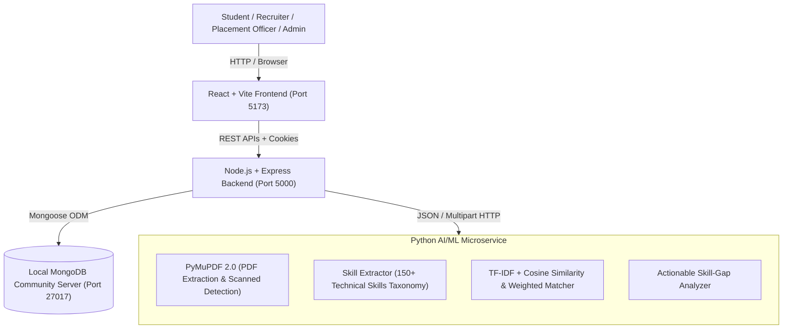

# AI-Powered Campus Placement Intelligence System

A full-stack web application combining full-stack web development with authentic, open-source AI/ML functionality to streamline campus recruitment for **Students**, **Recruiters**, **Placement Officers**, and **Administrators**.

---

## 1. System Architecture



---

## 2. Technology Stack & Mandatory Constraints

- **Total Service Budget:** ₹0 (100% open-source, local execution).
- **Frontend:** React 19, Vite 6, Tailwind CSS 4, React Router 7, Recharts, Lucide React.
- **Backend:** Node.js 24, Express 5, Mongoose 9, dotenv, CORS, Helmet, Cookie-Parser, Multer, Bcryptjs, JSONWebToken.
- **Database:** MongoDB Community Server (local Windows Service listening on `127.0.0.1:27017`).
- **AI/ML Service:** Python 3.14, FastAPI, Uvicorn, PyMuPDF 2.0 (`pymupdf`), Scikit-learn 1.9.1, python-multipart.

---

## 3. Core Functional Modules

### Module 1: Authentication & Role-Based Authorization
- Secure password hashing with `bcryptjs` (salt rounds: 10).
- Signed JSON Web Tokens (JWT) stored in HTTP-only, SameSite cookies.
- Strict role-based middleware (`protect`, `authorize("student", "recruiter", "placement_officer", "admin")`).
- Prevents mass assignment and unauthenticated privilege escalation.

### Module 2: Student Profiles
- Personal and academic data management: Roll number, Department, Batch, CGPA, Backlogs, and Phone.
- Technical skills inventory, project showcase, and internship experience.
- Student data privacy: students can only access their own profiles; recruiters/officers have authorized search access.

### Module 3: Secure Resume Upload & AI Parsing
- File-type verification: Enforces max 5 MB limit and inspects binary **magic bytes** (`%PDF-`) to reject renamed executables.
- PyMuPDF text extraction across multi-page resumes.
- Scanned document detection: identifies image-only PDFs lacking a selectable text layer and provides clear notices that OCR is required.
- Rule-based regex extraction mapped to a 150+ skill taxonomy across Languages, Frameworks, Databases, DevOps, and Data Science.
- Interactive student review: students can review, correct, or add missing skills, which automatically sync to their profile.

### Module 4: Company & Job Management
- Recruiter portal for company profile creation and job publishing.
- Granular specification of `requiredSkills` (must-have) and `preferredSkills` (good-to-have).
- Minimum academic eligibility rules: Minimum CGPA, target batch year, allowed departments, and maximum permitted backlogs.
- Multi-criteria job discovery and keyword/skill filtering.

### Module 5 & 6: Explainable AI Recommendation & Skill-Gap Analysis
- **Scoring Formula:**
  $$\text{Match Score} = 0.70 \times \text{Required Skill Match} + 0.15 \times \text{Preferred Skill Match} + 0.15 \times \text{TF-IDF Cosine Similarity}$$
- **Hard Eligibility Screening:** Evaluated independently from the skill score. Ineligible candidates receive clear explanations without falsifying the skill score.
- **Skill-Gap Analysis:** Categorizes missing competencies into **High Priority** (missing required skills) and **Medium Priority** (missing preferred skills), coupled with actionable learning paths.
- **Transparency Disclaimer:** Scores reflect profile alignment and do not represent a probability or guarantee of receiving a job offer.

### Module 7: Application Tracking & Recruitment Workflow
- Compound unique index (`{ student: 1, job: 1 }`) prevents duplicate applications.
- Pre-submission eligibility guard verifies CGPA and backlogs.
- Recruitment stage state machine: `Applied` $\rightarrow$ `Under Review` $\rightarrow$ `Assessment` $\rightarrow$ `Interview` $\rightarrow$ `Selected` / `Rejected` / `Withdrawn`.
- Complete append-only audit trail (`statusHistory`) recording timestamps, authorized recruiters, and notes.
- Selecting a candidate automatically updates their student placement status to `placed`.

### Module 8: Live Placement Analytics
- Real-time MongoDB aggregation pipelines (`$group`, `$unwind`, `$cond`, `$project`):
  - Total registered students, active drives, applications submitted, and placed students.
  - Institutional placement conversion percentage.
  - Interactive Recharts bar chart of recruitment stages.
  - Department-wise placement performance with average CGPA.
  - Skill demand vs. supply analysis detecting institutional talent gaps (e.g., high employer demand but low student coverage).

---

## 4. Local Startup & Execution Guide

### Prerequisites
1. **Windows 11** with PowerShell.
2. **Node.js** (v24+) & **npm** (v11+).
3. **Python** (v3.14+) with `py` launcher.
4. **MongoDB Community Server** (running as a local Windows Service on port `27017`).

---

### Option A: One-Click Startup (Recommended for Windows)

Double-click `start-services.bat` or run in PowerShell:
```powershell
.\start-services.ps1
```
This automatically boots all 3 services in separate windows:
- **Frontend Web UI:** `http://localhost:5173`
- **Node/Express API:** `http://localhost:5000`
- **AI/ML Service Docs:** `http://127.0.0.1:8000/docs`

---

### Option B: Manual Startup

**Step 1: Start Python AI/ML Microservice**
```powershell
cd ml-service
py -m uvicorn main:app --host 127.0.0.1 --port 8000 --reload
```
*Health check URL:* `http://127.0.0.1:8000/health`

**Step 2: Start Node.js Express Backend**
```powershell
cd backend
npm run dev
```
*Server runs at:* `http://localhost:5000`  
*API Health check:* `http://localhost:5000/api/health`

**Step 3: Start React Vite Frontend**
```powershell
cd frontend
npm run dev
```
*Frontend runs at:* `http://localhost:5173`

---

## 5. Instant Demo Seeding & Credentials

Populate the database with realistic companies (Google, Microsoft, Amazon), job openings, student profiles, and multi-stage applications:

```powershell
npm run seed
```

### Ready-to-Use Demo Accounts

| Role | Email | Password | Details |
| :--- | :--- | :--- | :--- |
| **Placement Officer** | `officer@campus.edu` | `OfficerPassword@123` | Full placement analytics, charts, student directory |
| **Administrator** | `admin@campus.edu` | `AdminPassword@123` | System oversight & configurations |
| **Recruiter (Google)** | `google.recruiter@campus.edu` | `RecruiterPassword@123` | SDE I openings, candidate review pipeline |
| **Recruiter (Microsoft)** | `microsoft.recruiter@campus.edu` | `RecruiterPassword@123` | AI/ML openings, candidate evaluation |
| **Recruiter (Amazon)** | `amazon.recruiter@campus.edu` | `RecruiterPassword@123` | Cloud DevOps openings |
| **Student (High Match)** | `priya.sharma@campus.edu` | `StudentPassword@123` | CGPA 9.25, CSE, 8 skills, Interview stage |
| **Student (Placed)** | `rahul.verma@campus.edu` | `StudentPassword@123` | CGPA 8.85, IT, ML specialist, Placed at MSFT |
| **Student (DevOps)** | `amit.patel@campus.edu` | `StudentPassword@123` | CGPA 7.90, ECE, Cloud & Linux focus |

---

## 6. Automated Verification & Testing Suite

All tests execute against local MongoDB and local services without mocks:

| Test File | Description | Status |
| :--- | :--- | :---: |
| `backend/tests/e2e.test.js` | Full 8-step lifecycle: Register $\rightarrow$ Profile $\rightarrow$ PDF Upload $\rightarrow$ AI Extract $\rightarrow$ Recruiter Job $\rightarrow$ AI Recommendation $\rightarrow$ Apply $\rightarrow$ Status $\rightarrow$ Analytics | **PASSED** |
| `backend/tests/auth.test.js` | 9 Tests: Registration, hashing, JWT cookies, role-based 403, duplicate rejection | **PASSED** |
| `backend/tests/studentProfile.test.js` | 6 Tests: Profile CRUD, CGPA range validation, cross-user privacy | **PASSED** |
| `backend/tests/resume.test.js` | 6 Tests: Magic-byte PDF check, PyMuPDF extraction, auto-sync, student review | **PASSED** |
| `backend/tests/job.test.js` | 7 Tests: Company creation, job posting, student forbidden, skill/CGPA filters | **PASSED** |
| `backend/tests/recommendation.test.js` | AI matching, TF-IDF cosine similarity, hard eligibility, skill gaps | **PASSED** |
| `backend/tests/application.test.js` | 7 Tests: Duplicate prevention, eligibility check, status history, withdrawal | **PASSED** |
| `backend/tests/analytics.test.js` | MongoDB aggregations, placement rate, stage breakdown, skill gap deficit | **PASSED** |

Run the complete end-to-end integration test:
```powershell
npm run test:e2e
```

To run any test suite individually:
```powershell
node backend/tests/auth.test.js
node backend/tests/studentProfile.test.js
node backend/tests/job.test.js
node backend/tests/application.test.js
node backend/tests/analytics.test.js
node backend/tests/resume.test.js
node backend/tests/recommendation.test.js
```

---

## 6. Directory Structure

```text
campus-placement-system/
├── package.json                   # Root workspace scripts
├── .gitignore                     # Git exclusion rules
├── backend/
│   ├── config/
│   │   └── db.js                  # Mongoose connection & lifecycle events
│   ├── controllers/
│   │   ├── auth.controller.js
│   │   ├── studentProfile.controller.js
│   │   ├── resume.controller.js
│   │   ├── job.controller.js
│   │   ├── recommendation.controller.js
│   │   ├── application.controller.js
│   │   ├── analytics.controller.js
│   │   └── health.controller.js
│   ├── middleware/
│   │   ├── auth.js                # protect & authorize RBAC
│   │   ├── errorHandler.js        # Centralized error handler
│   │   └── notFound.js            # 404 handler
│   ├── models/
│   │   ├── User.js
│   │   ├── StudentProfile.js
│   │   ├── ResumeAnalysis.js
│   │   ├── Company.js
│   │   ├── Job.js
│   │   └── Application.js
│   ├── routes/
│   ├── tests/                     # Automated integration test suite
│   ├── uploads/resumes/           # Private local resume storage
│   ├── .env
│   ├── .env.example
│   ├── package.json
│   └── server.js
├── ml-service/
│   ├── skills_dataset.py          # 150+ skills taxonomy
│   ├── parser.py                  # PyMuPDF text & scan detection
│   ├── extractor.py               # Boundary-aware skill extractor
│   ├── recommender.py             # TF-IDF cosine similarity & gap analyzer
│   └── main.py                    # FastAPI microservice entrypoint
└── frontend/
    ├── src/
    │   ├── components/            # Navbar, ProtectedRoute
    │   ├── context/               # AuthContext
    │   ├── pages/
    │   │   ├── LandingPage.jsx
    │   │   ├── LoginPage.jsx
    │   │   ├── RegisterPage.jsx
    │   │   ├── student/           # Dashboard, Profile, Resume, Matches, Jobs, Applications
    │   │   ├── recruiter/         # Hub, PostJob, CandidateReview
    │   │   └── officer/           # AnalyticsDashboard, StudentDirectory
    │   ├── App.jsx                # Client-side router
    │   └── main.jsx
    ├── index.html
    ├── vite.config.js             # Vite + Tailwind + /api proxy
    └── package.json
```
